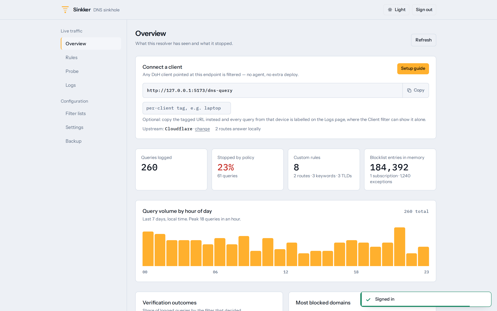
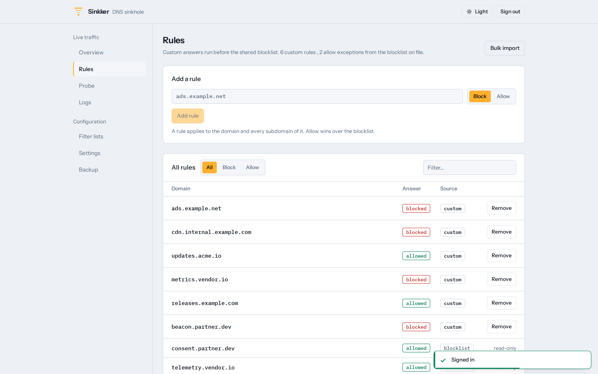
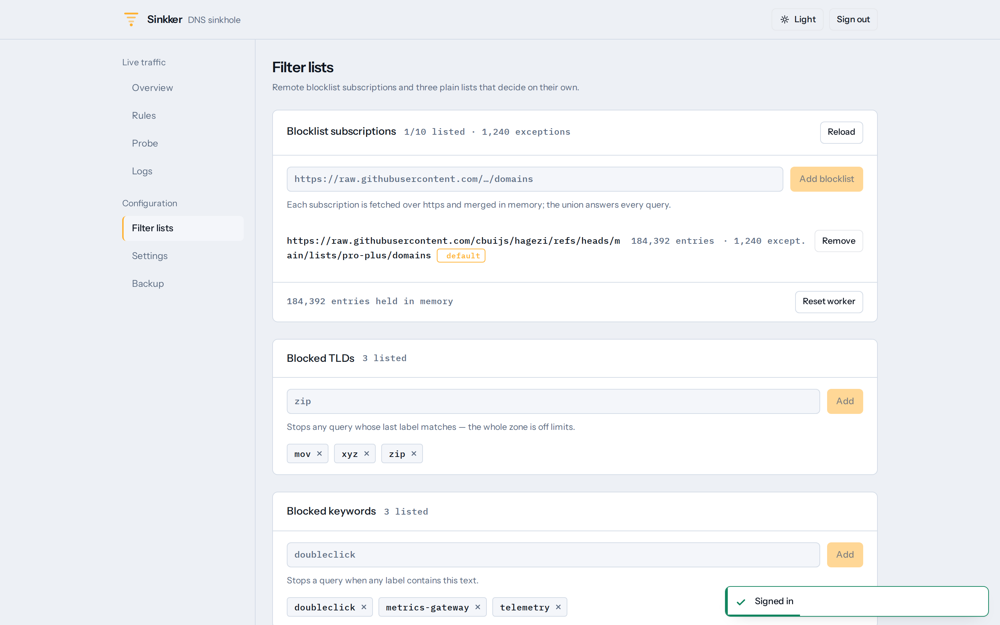
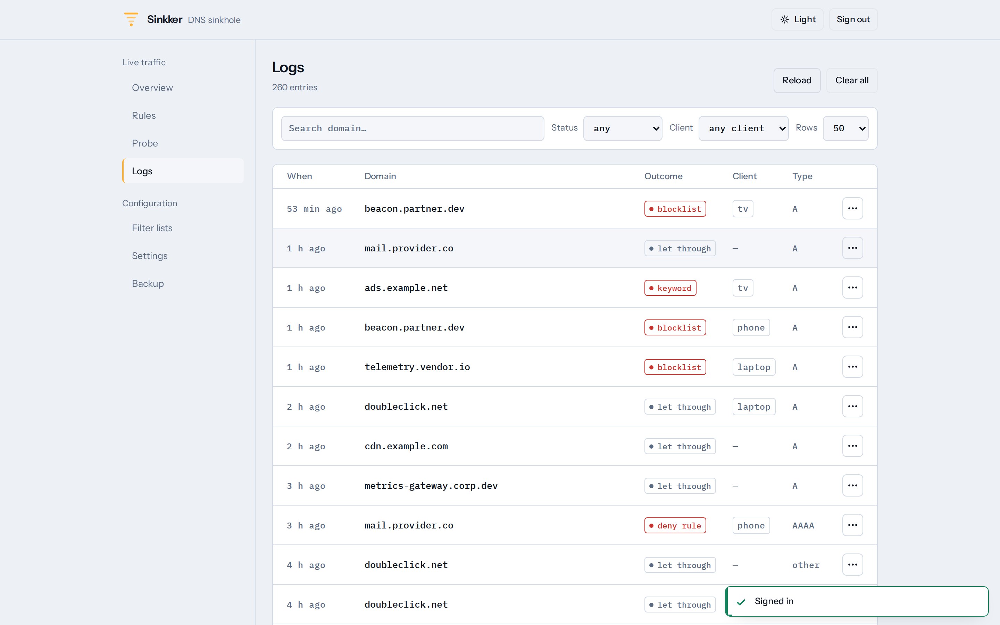
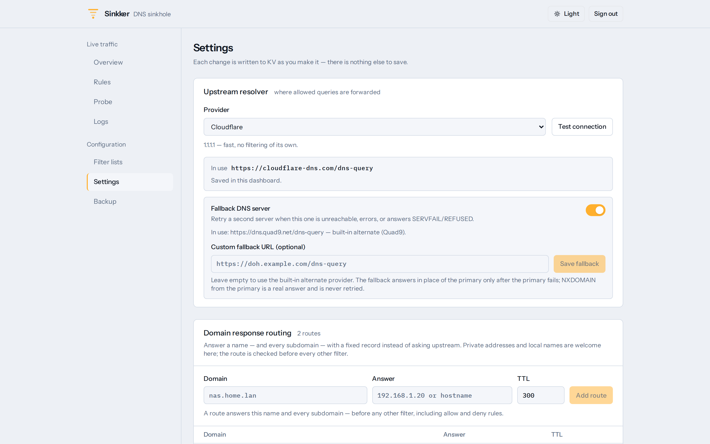
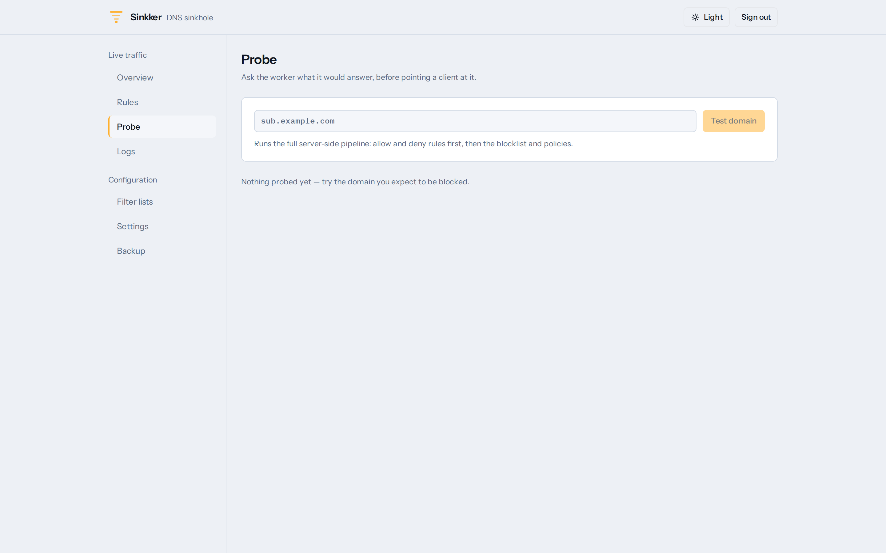
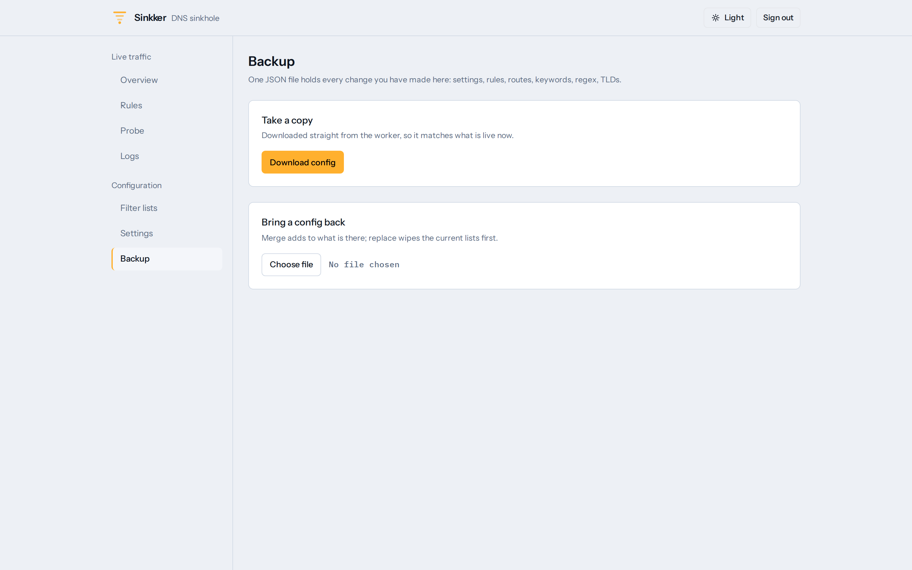
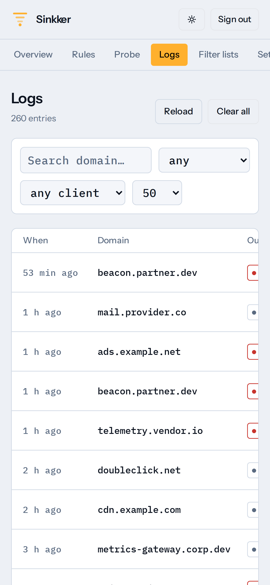

<p align="center">
  
</p>

<h1 align="center">Sinkker</h1>

<p align="center">
  <b>A DNS sinkhole that runs on Cloudflare Workers.</b><br />
  Block ads, trackers and malware for every device on your network — no Raspberry Pi to power,
  no VPS to patch, no DNS container to babysit.
</p>

<p align="center">
  <a href="https://github.com/Stillman7896/sinkker/actions/workflows/ci.yml"></a>
  <a href="#license"></a>
  <a href="https://github.com/Stillman7896/sinkker/stargazers"></a>
  
  
  <a href="CONTRIBUTING.md"></a>
</p>

<p align="center">
  <a href="https://deploy.workers.cloudflare.com/?url=https://github.com/Stillman7896/sinkker"></a>
</p>

<p align="center">
  <picture>
    <source media="(prefers-color-scheme: dark)" srcset="docs/img/overview-dark.png" />
    
  </picture>
</p>

Sinkker answers DNS over HTTPS (RFC 8484) from the edge, decides each query
against a blocklist and your own rules, and gives you a small dashboard to run
it. It is the Pi-hole-shaped hole in a serverless setup: the blocking runs on
Cloudflare's network, close to the client, and the free plan is enough for a
household or a small office.

## Features

**Blocking that covers more than a domain list**

- **Remote blocklists, several at once.** Subscribe up to 10 documents; plain
  domains, hosts files and AdBlock syntax can be mixed, they are merged into one
  set, and `@@` exceptions in a list are honoured as allow rules.
- **Your own allow and deny rules**, with subdomain matching — allow
  `example.com` and everything under it is allowed, deny-one-name still works.
- **Blocked TLDs, keywords and regex** for the junk a blocklist misses — each
  behind its own toggle, so you only pay for what you switch on.
- **DNS rebinding protection**: internal and special-use names are refused, and a
  private address in an answer (including cloud metadata `169.254.169.254`) is
  dropped before the client sees it.
- **IDN homograph blocking** for punycode lookalike domains, one toggle.
- **Choose the blocked answer**: NXDOMAIN, REFUSED, a null IP (`0.0.0.0` / `::`)
  or NODATA — one setting for every filter, applied without a redeploy.
- **Response routes**: answer a name yourself — point `nas.home.lan` at a LAN
  address, or alias one name onto another with a CNAME.

**Privacy**

- **DoH in and DoH out.** Clients speak DNS over HTTPS; upstream does too.
- **Pick the resolver**: Cloudflare, Cloudflare for families, Quad9, Google,
  AdGuard, or any DoH endpoint you name — switchable from the dashboard without
  a redeploy.
- **Oblivious DoH (RFC 9230)** if you want no single hop to learn both the name
  and your address, and **automatic failover** with negative caching so one dead
  upstream is not an outage.
- **No telemetry and no runtime dependencies** — the whole resolver is `fetch`
  plus Web Crypto. Query logs live in *your* D1 database and nowhere else.

**A dashboard, not a config file**

- **Overview** with the DoH endpoint to hand out, query counts, what share of
  queries was blocked and a client-tag builder for per-device attribution.
- **Rules** with source badges, one **Probe** box that runs a real domain through
  the same pipeline a live query takes, and **Filter lists** with per-subscription
  entry counts, fetch errors and one **Reload** button.
- **Logs** in D1: search, status and per-client filters, paging, retention.
- **Backup**: export the complete configuration (settings, rules, routes, lists)
  to JSON and import it back.
- Light and dark themes, keyboard and mobile friendly, single sign-in — no
  browser password dialog, just a session cookie.

**Built to be left alone**

- **One-click deploy** to your Cloudflare account; KV and D1 are provisioned for
  you, and there is nothing else to run.
- **`/healthz`** answers with real state — effective settings, resolved upstream,
  blocklist health — and lists reasons when something is degraded.
- **Escape hatch.** If a runaway blocklist configures the Worker into a corner,
  the dashboard's failure screen prints a single password-gated `curl` that wipes
  the configuration without touching your deployment variables or your logs.
- **184 tests**, typechecked and linted on every push, with the dashboard build
  verified against `ui/` in CI.

## Quick start

**Fastest path** — click *Deploy to Cloudflare*, pick a password when asked, and
Cloudflare clones the repo, provisions KV + D1 and deploys. Then point a client at
the URL from the dashboard's Overview page:

```
https://<your-worker>.workers.dev/dns-query
```

**From a clone** — Node 22+, a Cloudflare account, and four commands:

```sh
npm ci
wrangler kv namespace create RULES --binding RULES --update-config
wrangler secret put DASHBOARD_PASSWORD
npm run deploy
```

(The committed `wrangler.toml` carries the maintainer's resource ids;
`--update-config` swaps in yours. Add the optional D1 database — or delete the
binding, the dashboard just shows no logs — per
[docs/operations.md](docs/operations.md#manual-in-five-commands).)

Browser: *Settings → Privacy → DNS over HTTPS → custom*, paste the URL. Router,
AdGuard Home, dnsmasq: same URL wherever a DoH endpoint goes. Full instructions,
including the optional D1 setup for query logs, are in
[docs/operations.md](docs/operations.md#deploy).

## Screenshots

| Rules | Filter lists |
|---|---|
| [](docs/img/rules.png) | [](docs/img/lists.png) |
| **Logs** | **Settings** |
| [](docs/img/logs.png) | [](docs/img/settings.png) |
| **Probe** | **Backup** |
| [](docs/img/probe.png) | [](docs/img/backup.png) |

<p align="center">
  <picture>
    <source media="(prefers-color-scheme: dark)" srcset="docs/img/mobile-overview.png" />
    
  </picture>
</p>

## Documentation

| | |
|---|---|
| [Configuration reference](docs/configuration.md) | Deploy variables, settings, API endpoints, list formats, upstream resolver, logs |
| [How it works](docs/architecture.md) | Filter precedence, storage design, the free-plan budget, source layout |
| [Deploy, upgrade, troubleshoot](docs/operations.md) | Setup, client configuration, upgrading, symptom → cause table |
| [Contributing](CONTRIBUTING.md) | Setup, test expectations, asset and screenshot generation |
| [Security policy](SECURITY.md) | Private reporting, scope, hardening expectations |
| [Changelog](CHANGELOG.md) | What changed, and what to do about it |

## Community

- Bugs and feature requests: [issues](https://github.com/Stillman7896/sinkker/issues)
  (the templates ask for the few things needed to reproduce).
- Security problems: [private report](https://github.com/Stillman7896/sinkker/security/advisories/new),
  never a public issue.
- Pull requests are welcome — see [CONTRIBUTING.md](CONTRIBUTING.md);
  `CODE_OF_CONDUCT.md` applies everywhere in this project.

## Credits

- Blocklists are fetched at runtime from their publishers, by default
  [HaGeZi's DNS blocklists](https://github.com/hagezi/dns-blocklists), which are
  published under **GPL-3.0**. Sinkker stores only the URL: no list content is
  bundled in this repository, and the list's own license governs any copy you
  redistribute.
- Runs on [Cloudflare Workers](https://developers.cloudflare.com/workers/), with
  KV, D1 and Workers Builds.
- Not affiliated with Cloudflare, Pi-hole, AdGuard or the blocklist publishers.

## License

[Unlicense](LICENSE) — public domain. Use it, fork it, sell it, ship it in a
product; no attribution required. If you would rather have a warranty-shaped
permissive license, the code is yours to relicense under MIT or Apache-2.0.
